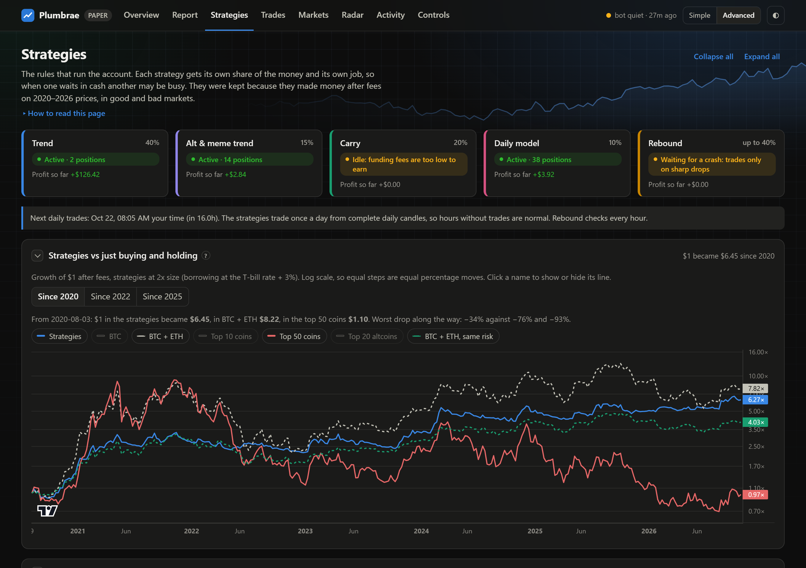
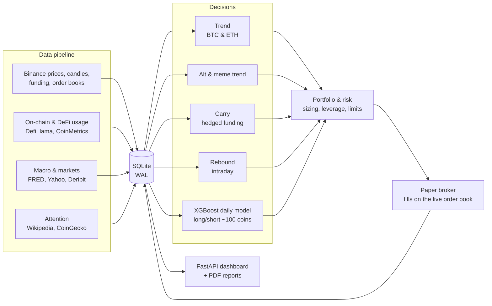
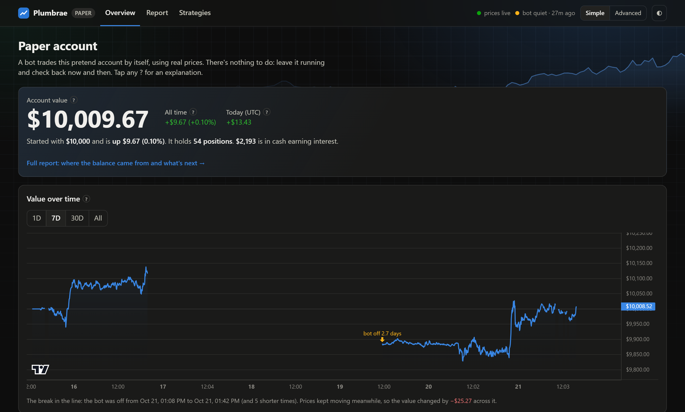
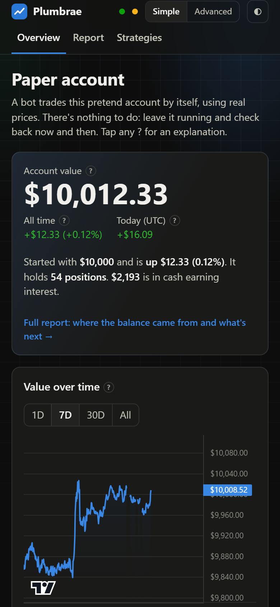
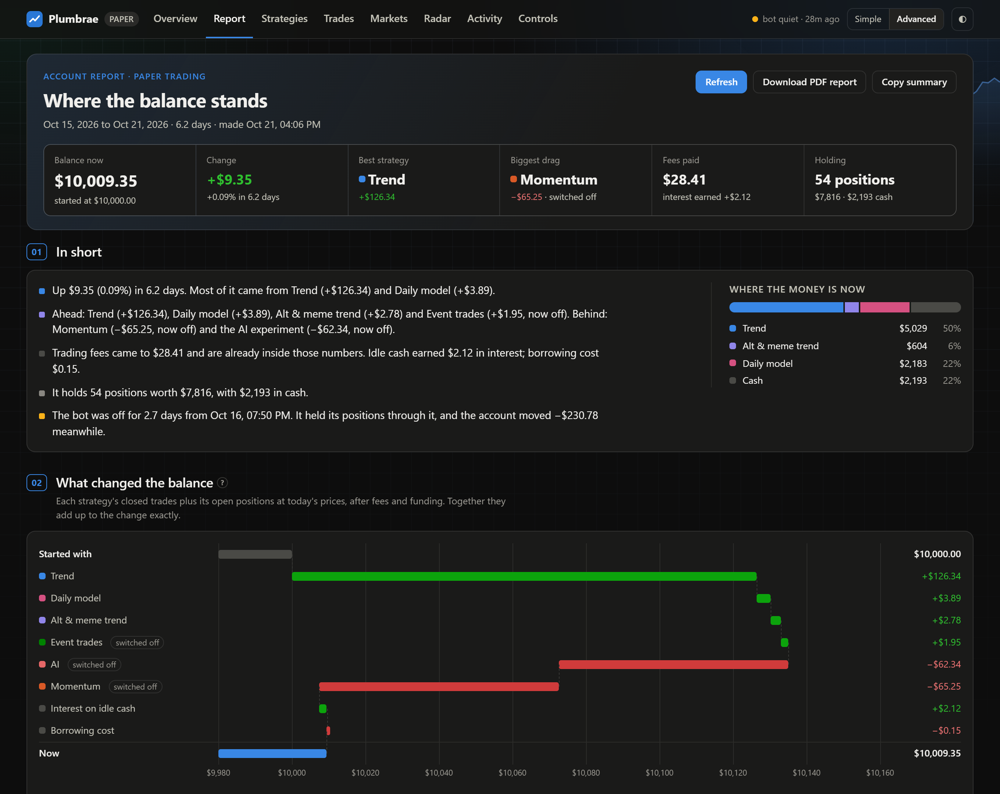
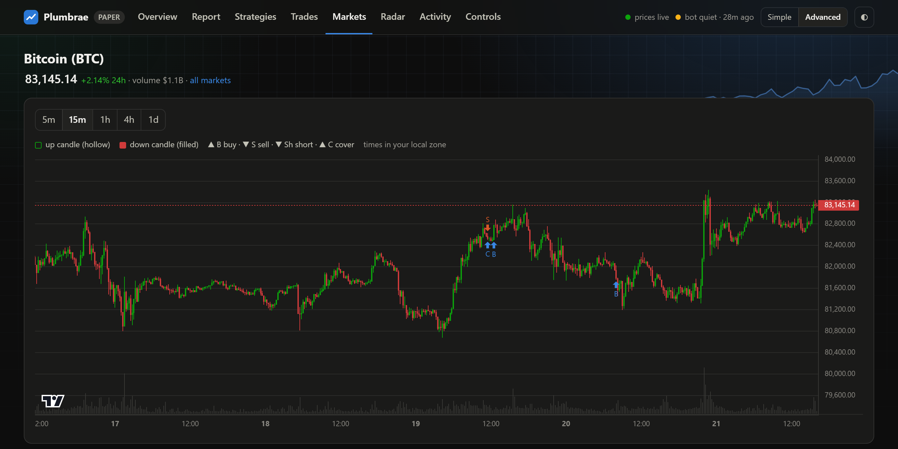

# Plumbrae: an AI-driven crypto trading system

An autonomous trading bot I designed and built. It does the following:
- collects data on ~680 crypto futures markets;
- runs four rule-based strategies alongside a machine-learning model;
- paper-trades around the clock on live exchange prices from a cloud server;
- reports everything through a web dashboard built for beginners as well as experts.

> **The source code is private** because it contains the trading strategies. This page shows what the system does, how it was built and tested, and what I learned. **The code is available to employers on request.**

| | |
|---|---|
| **What** | End-to-end trading system: data pipeline → strategies and ML model → risk and execution → dashboard |
| **Scale** | ~680 futures markets (including 160+ delisted ones) · ~200 model inputs · 6 years of data · 159 automated tests |
| **Stack** | Python, pandas, XGBoost, FastAPI, SQLite, JavaScript, Linux (systemd) on Oracle Cloud |
| **Built** | Solo, 2026, with [Claude Code](https://claude.com/claude-code) as an AI pair programmer |
| **Status** | Paper trading (no real money) since October 2026 |

---

## What makes this project different

Building a trading bot that looks good in a backtest is easy. Most of my time went into **trying to prove my own results wrong**, and then cutting whatever didn't survive.

| Component | What it first looked like | The honest test | Decision |
|---|---|---|---|
| **Momentum strategy** | +27% a year | Re-tested on every coin that traded at the time, including the 160+ that later collapsed or were delisted: **+5% a year with a −57% worst drop** | Switched off |
| **Alt & meme trend strategy** | +28% a year | Same survivorship fix: **+13.5% a year** | Kept, with lower expectations |
| **15-minute prediction model** | Trained daily, scored every coin | 12 training runs; out-of-sample AUC 0.50–0.53, log-loss equal to always guessing the average | Switched off |
| **Trading on news** | 20,000+ headlines a month scored for credibility and impact | About 3,000 qualifying stories since 2020 averaged −0.24% per trade, the same as random entries (the fees) | Switched off |
| **News as a model input** | Part of the daily model's inputs | Ablation: the model **did better without it** (held-out Sharpe 0.63 vs 0.50, same predictive correlation) | News pipeline removed |
| **4-hourly AI ranking strategy** | +18% a year in its walk-forward test | Returns fell every year (+52% → +24% → +9% → −3%); lost money live | Code deleted |
| **"Buy the week's biggest losers"** | My own trading idea | −55% a year across 2020–2026, at every volume filter tested | Never added |

What's left is what earned money after fees on a fair test.

---

## Architecture

- **One code path for live trading and backtesting.** The live bot and the backtester call the same strategy functions, so they can't drift apart.
- **Point-in-time data.** Every input is used only from the moment it was actually public, so tests can't peek into the future.
- **Runs 24/7 on a small Linux server.** It runs under systemd, with automatic backups and weekly model retraining. Profiling cut the backtest's peak memory from ~1 GB to ~415 MB.

---

## The machine-learning model

Every day, an XGBoost model ranks the 100 most-traded perpetual futures. It **buys the top fifth and shorts the bottom fifth**. The two sides are sized to the same exposure to Bitcoin, so the market's overall direction mostly cancels out, and only the model's stock-picking skill is left.

**~200 inputs**, many of them not prices:

| Kind | Examples |
|---|---|
| The coin's own trading | Returns over 1–90 days, volatility, volume surges, taker buying pressure, funding, beta to BTC |
| Real-world usage | Fees users pay to the protocol, DEX volume, active addresses, total value locked |
| Attention | Wikipedia page views |
| The crypto market | Breadth, open interest, options implied volatility, Fear & Greed, stablecoin supply |
| Outside markets | S&P 500, VIX, the dollar, gold, Treasury yields, Fed net liquidity |

**How it was tested:**
- **Walk-forward:** each month is predicted only by models trained on earlier data, with an 8-day gap so that no information leaks across.
- **Hold-out period:** every design choice was made on 2022–2024 data. January 2025 – September 2026 was kept untouched and run at the end.
- **Survivorship-bias free:** the test includes every delisted market (LUNA, FTT, …), so the collapses are in it.
- **Robustness:** the test was rerun with several random seeds, and the live model averages three of them.

| Walk-forward, after costs | Sharpe ratio |
|---|---|
| Development period (2022–24) | ~2.0–2.3 |
| **Hold-out period (2025–26, unseen)** | **~0.5–0.9** |

The drop from development to hold-out is the most important number on this page. It's why I report hold-out results, not the flattering ones.

**Feature ablation:** I added data sources in stages and measured each one.

| Inputs | Sharpe ratio (development period) |
|---|---|
| Price, volume and funding only | 0.80 |
| + on-chain usage and attention | 1.14 |
| + market-wide and macro data | 1.45 |

---

## Results (backtest)

The full portfolio at 2x leverage, from August 2020, after fees, funding and borrowing costs. The coin-picking strategies include delisted coins.

| $1 became | Since Aug 2020 | Since 2022 | Since 2025 | Worst drop |
|---|---|---|---|---|
| **Plumbrae strategies** | **$6.45** | **$2.32** | **$1.27** | **−34%** |
| Holding BTC + ETH | $8.22 | $1.19 | $0.84 | −76% |
| BTC + ETH at the same risk | $4.13 | $1.44 | $1.01 | −47% |
| Holding the top 50 coins | $1.10 | $0.14 | $0.36 | −93% |

**How to read this:**
- **Holding Bitcoin and Ethereum made more over the full period,** because it captured the big bull years in full.
- **The strategies lost far less in crashes.** Their worst drop was −34%, against −76% for holding.
- **They were ahead since 2022 and since 2025,** and ahead at equal risk.
- **The full-period backtest still flatters them somewhat,** because the strategies were chosen knowing how 2020–2026 went.

These are backtests, not live returns. The live paper account started in October 2026.

---

## The dashboard

The dashboard was built so a beginner can follow the account. **Simple mode** shows only what matters: the balance, a chart, what the bot holds and why. **Advanced mode** adds every trade, every market, model diagnostics and the bot's scheduled jobs.

| Simple mode | On a phone |
|---|---|
|  |  |

**Report page:** a plain-English account of where every dollar came from, split exactly by strategy. It downloads as a PDF report.

**Coin pages:** candlestick charts marked with each buy and sell the bot made.

---

## How I used AI to build it

I built Plumbrae with **Claude Code** as a pair programmer. Working this way taught me that AI makes writing code fast, but the judgement still has to be human:

- **I set the direction:** what to build, which ideas to test, and what counted as evidence. I also had a trading idea of my own (buying the week's biggest losers) tested before deciding against it.
- **I made the AI prove its work:** 159 automated tests, walk-forward backtests, ablation experiments, and headless-browser checks of every dashboard page.
- **I ordered a critical review of every component** and acted on it. That review found the survivorship bias in the strategy backtests and led to cutting four components.

---

## What I learned

1. **Survivorship bias is everywhere.** Testing only on coins that still exist made two strategies look twice as good as they were.
2. **Removing things is a skill.** Four of the components I built, including a news pipeline handling 20,000+ headlines a month, didn't pay off once tested honestly, so I cut them.
3. **Hold-out results are the real results.** A Sharpe ratio of 2 in development became ~0.7 on unseen data. Reporting the second number is what makes the first one credible.
4. **Fees decide most strategies.** Of 26 intraday trading signals I tested, only one beat trading costs; most lost almost exactly the fees.
5. **Design for the reader.** A system nobody can understand won't be trusted, hence the Simple mode and the plain-English reports.

---

Research project, not financial advice. Paper trading only; backtested results don't guarantee future returns. © 2026 Syed Ridwan. All rights reserved.
